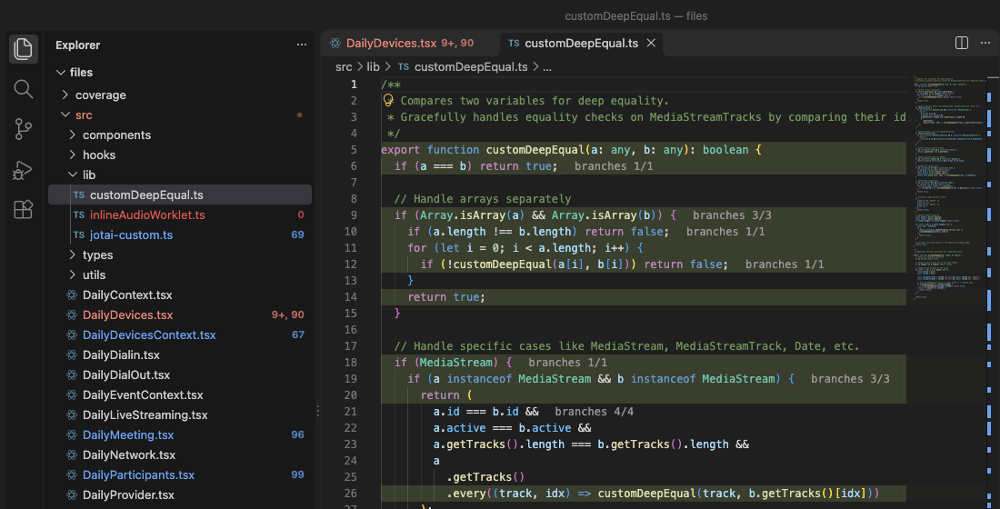

# Code Coverage & LCOV Viewer

Code Coverage reads LCOV, Cobertura, JaCoCo and Clover reports, marks covered and missed source lines, and lists file totals in the Explorer.

## Free

- Reads `lcov.info`, Cobertura XML, JaCoCo XML and Clover XML
- Marks covered and missed lines in the editor
- Shows file totals and the least-covered files in the Explorer and in a summary page (Code Coverage: Show Summary)
- Reads one report per folder, so a test run that writes both `lcov.info` and `clover.xml` is counted once
- Works locally with no sign-in and no network calls

## Zovo Pro tools

Zovo Pro: USD 19 once covers these project workflows.

- Diff coverage for lines changed against `main`
- Export line and branch results as HTML or Markdown
- Save coverage history and check a threshold with JSON output for CI

Each Pro tool has 3 free tries. Pro tools run only when you use their commands, the links in the summary page or the Zovo Pro entries when you right-click a report or a covered file in the Explorer. You can hide them with the `codeCoverage.showProTools` setting. Coverage files and source stay on your computer.

## Use it

Put an LCOV or XML report anywhere in the workspace. Code Coverage finds `lcov.info`, `coverage.xml`, `jacoco.xml` and `clover.xml` files. When one folder holds several formats of the same run, it reads `lcov.info` first, then Cobertura, JaCoCo and Clover. Use Code Coverage: Refresh Reports to reload them. You can change the report paths in Settings.

## Limits

The first release reads local report files and doesn’t launch a test runner. When reports share a source line, the highest hit count is used; Clover branch counts aren’t available. The report search is capped at 100 matches per pattern. Source paths are resolved from the workspace root. An absolute path written on another machine (for example in CI) is matched to the same path ending inside the workspace. Diff coverage needs Git and a local `main` ref and checks committed changes between `main` and `HEAD`.

## Support Zovo

Zovo Pro: USD 19 once, every Zovo viewer. [Get Zovo Pro on GitHub Sponsors](https://github.com/sponsors/theluckystrike/sponsorships?tier_id=679878) to turn on the Pro tools in this extension and in the other Zovo extensions you use. The free features stay free.

Zovo extensions have no ads and no tracking. They are made by [theluckystrike](https://github.com/theluckystrike) on GitHub. You can also support the work with no Pro:

- [Sponsor on GitHub](https://github.com/sponsors/theluckystrike)
- [PayPal](https://www.paypal.com/paypalme/najzzz)
- [Follow theluckystrike on GitHub](https://github.com/theluckystrike)

### Need your format supported?

Open a [format request](https://github.com/theluckystrike/code-coverage-vscode/issues/new?template=format-request.yml) with a sample file, and I reply there whether it can be done. For USD 299 once, through [this GitHub Sponsors tier](https://github.com/sponsors/theluckystrike/sponsorships?tier_id=679995), I add your file format or a missing feature to this extension, with tests, within 7 days.

## More tools by Zovo

- [JavaScript Playground & TypeScript Scratchpad with Inline Values (Live JS and TS Runner)](https://marketplace.visualstudio.com/items?itemName=zovo.zovo-js-ts-scratchpad) shows the value of each line of JavaScript or TypeScript as you type.
- [Run C++ and C Code: One-Click Compile with GCC, G++, Clang (CPP Runner, Input Panel)](https://marketplace.visualstudio.com/items?itemName=zovo.zovo-run-cpp) compiles and runs the current C or C++ file with gcc or clang.
- [SARIF Viewer (CodeQL, Semgrep & Static Analysis Results)](https://marketplace.visualstudio.com/items?itemName=zovo.zovo-sarif-viewer) shows SARIF results from CodeQL, Semgrep and ESLint, with filters.
- [Tag Auto Rename & Close Tag Sync (Matching Tag Highlight, JSX, Vue)](https://marketplace.visualstudio.com/items?itemName=zovo.zovo-auto-rename-tag) renames and closes the matching tag as you type in HTML, JSX and Vue.
- [Code Screenshot & Code Snapshot (Copy Code as Image, PNG/SVG)](https://marketplace.visualstudio.com/items?itemName=zovo.zovo-code-screenshot) copies the selected code as a PNG in your editor theme.

See [all Zovo extensions on the Marketplace](https://marketplace.visualstudio.com/publishers/zovo).

## License

MIT
